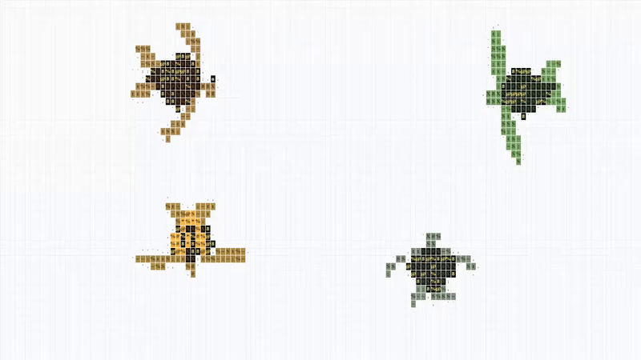

# ascii-turtles 🐢

> Biomimetic sea turtles swimming in ASCII on HTML canvas. Zero dependencies.

```text
               .---.
              /     \   _
             | () () | / )
        .----'       '--'
       /   :;;t%SX8#@   \
      /  :;t%SX8#@8%t:   \==--.
     |  ;t%SX8#@@#8X%t;   |   (
      \  :;t%SX8#@8%t:   /==--'
       \   :;;t%SX8#@   /
        '----.       .--'
             | () () | \_)
              \     /
               '---'
```



Realistic sea turtle kinematics rendered entirely with monospace ASCII characters on an HTML `<canvas>`. Includes true differential flipper propulsion, scute pattern simulation, school-of-fish avoidance, interactive ripples, and four distinct sea turtle species.

Inspired by [ascii-sharks](https://github.com/stackedlol/ascii-sharks).

---

## ✨ Features

- **Biomimetic Flipper Kinematics**: Turtles flap their front flippers downward and backward to produce thrust, with glide decay and asymmetric single-flipper steering pivots.
- **Scute & Shell Anatomy**: Procedural carapace rendering with vertebral, costal, and marginal scute layers.
- **Intelligent Collision Avoidance**: Field-of-view scanning prevents shell collisions, yielding to approaching turtles gracefully.
- **Species Roster**:
  - 🐢 **Loggerhead** (*Caretta caretta*) — Massive head, broad reddish-brown shell, powerful stroke.
  - 🐢 **Green Sea Turtle** (*Chelonia mydas*) — Streamlined teardrop carapace, graceful long flippers.
  - 🐢 **Hawksbill** (*Eretmochelys imbricata*) — Sharp curved beak, intricate serrated scute margins.
  - 🐢 **Olive Ridley** (*Lepidochelys olivacea*) — Compact, rounded olive-grey carapace with rapid stroke frequency.
- **Zero Dependencies**: Pure Vanilla JS / TypeScript. Works out of the box with `turtles.js` or modern bundlers (Vite, Webpack, Next.js).
- **Responsive & Accessible**: Auto-resizes, respects `prefers-reduced-motion`, and pauses when out of viewport.

---

## 🚀 Quick Start

### 1. Plain HTML (Zero Build Tools)

Drop `turtles.js` and an HTML canvas into any page:

```html
<!doctype html>
<html>
  <head>
    <style>
      body { margin: 0; background: #000; overflow: hidden; }
      canvas { width: 100vw; height: 100vh; font-family: monospace; }
    </style>
  </head>
  <body>
    <canvas id="ocean"></canvas>

    <script src="turtles.js"></script>
    <script>
      const canvas = document.getElementById("ocean");
      const engine = new TurtleEngine(canvas);
    </script>
  </body>
</html>
```

### 2. Modern Bundlers & TypeScript (Vite / Next.js)

```bash
npm install
npm run dev
```

```typescript
import { TurtleEngine } from "ascii-turtles";

const canvas = document.querySelector("canvas")!;
const engine = new TurtleEngine(canvas, [
  { kind: "loggerhead", size: 1.1 },
  { kind: "green", size: 1.0 },
  { kind: "hawksbill", size: 0.9 },
  { kind: "oliveridley", size: 0.8 },
]);
```

### 3. React Component

```tsx
import { AsciiTurtles } from "ascii-turtles/react";

export default function OceanView() {
  return (
    <div style={{ width: "100vw", height: "100vh", background: "#000" }}>
      <AsciiTurtles
        turtles={[
          { kind: "loggerhead", size: 1.0 },
          { kind: "green", size: 0.95 },
        ]}
      />
    </div>
  );
}
```

---

## 🕹️ Interactive Controls & URL Parameters

You can customize the simulation directly via URL search parameters:

```text
http://localhost:5173/?turtles=loggerhead,green,hawksbill,oliveridley
```

- **Click / Tap**: Spawns an acoustic underwater ripple that deflects nearby fish and alerts turtles.
- **Mouse Hover**: Pointers cast a subtle presence that schools of baitfish flee from.

---

## 🧬 Kinematics & Mathematical Model

The sea turtle swimming engine uses biomimetic mechanics:
1. **Power Stroke & Recovery**: Thrust is generated exclusively during the downward/rearward power stroke ($\sin(\omega t) < 0$), with exponential deceleration during the glide recovery phase.
2. **Asymmetric Flipper Steering**: When turning, the turtle pivots around the slower flipper rather than its geometric center, mimicking real-world flipper rowing.
3. **Ray-Cast Margin Buffer**: Predicts trajectories $40\text{px}$ ahead to yield right-of-way and prevent head-on shell collisions.

---

## 📄 License

MIT © 2026 [Lazaro Guerrero Losada](https://github.com/lazaro-guerrero-losada)
